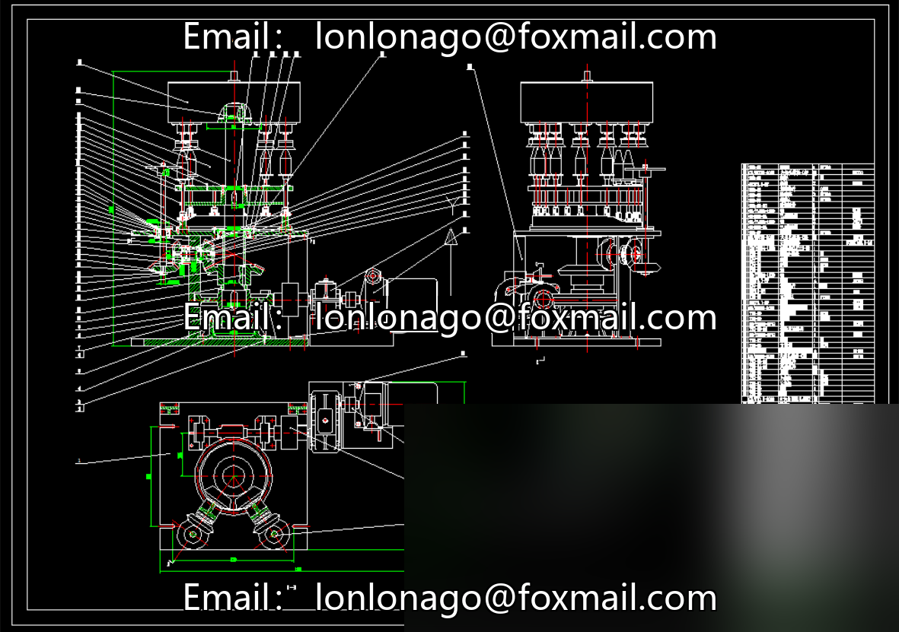
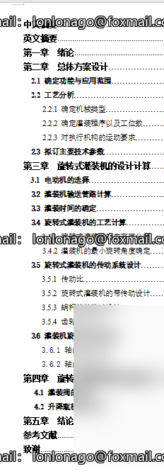
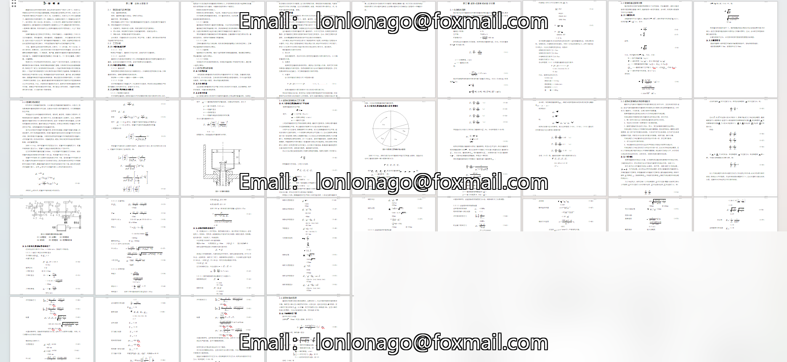

# Rotary beer filling machine CAD design

## Body

Rotary beer filling machine CAD design 343 beer filling machine design beer filling machine design CAD diagram beer filling machine design CAD figure beer filling machine two-dimensional diagram rotary beer filling machine design

Rotary beer filling machine design (complete CAD drawings plus design specification)

The price is the amount, and will send it as specified.

Purchase requirements
1. Materials are all drawings type (not physical), the network is replicable, transaction completion does not accept refunds, if there are any issues please consult before purchase.
2. All materials are provided for beginners as structural design references and learning purposes; please do not use them for illegal purposes.
3. Design is a comprehensive test; it is recommended not to copy or copy directly. For finished designs, there is no after-sales modification service.

The design covers a complete CAD set for the rotary beer filling machine along with a design manual, with multiple mechanical drawings and design scheme contents visible.

<!-- AI_ENRICHED -->

## Images

## Payment

Here is a pay link on Stripe ( https://buy.stripe.com/3cs8yP7sY87d0vu9AB ). Please contact me lonlonago@foxmail.com after funding $89, and I will send you a complete data files , thank you!

